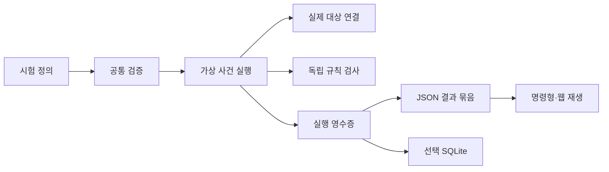

# 개발팀용 CRDT·동기화 검증 설계

## 1. 결정과 증거 범위

대상은 개발팀의 동기식 CRDT·동기화 검증이다. 실제 대상 연결, 독립 검사, 실패 파일, 자동 검사 종료 코드를 주기능으로 둔다. 기존 OR-Map·가상 시간·고정 난수·사건 순서를 재사용하고 웹은 같은 기록을 설명한다. [PROJECT R01–R12, RESEARCH S01–S08]

기존 설계는 `92ebbea:.planning/DESIGN.md`, SHA-256 `6c734364d5bd02576e28709a3635c183f56fcaa576774f617f73efd167ae2f95`다. 공유 TypeScript 실행, 브라우저 독립 실행, 선택 저장, 수동 배포 원칙을 계승한다. 실제 전달마다 상태를 반영하는 규칙은 기존 스텝 직후 상태 정책을 대체한다. [R09/R11]

현재 구현 완료를 주장하지 않는다. Yjs 13.6.27의 256 seed × 2회 연결, 기록 재생, 의도적 누락 검출, 대상별 충돌 의미는 `evidence/2026-10-14/yjs-results.json`이 입증하는 작은 실험이다. 범용 연결 API·축소·CLI·웹·저장 연결은 후속 제품 합격 조건이다.

## 2. 대안과 도입 판단

| 선택지 | 효용 | 비용·반례 | 결정 |
| --- | --- | --- | --- |
| 학습 실험기 정비 | 기존 결함·설명 개선 | 외부 대상 검사 부재 | 기준 예제로 계승 |
| fast-check와 얇은 연결 | 생성·축소·seed/path 재생 | 메시지·장애·기록·재생을 사용자마다 구현 | 생성·축소는 사용 |
| 작은 공통 실행기·연결·검사 | 실제 구현·업무 규칙·파일·CI 연결 | 초기화·전달·버전 통제 필요 | 첫 범위로 선택 |
| Jepsen/Antithesis 수준의 환경 | 실제 외부 시스템과 숨은 환경 동작 검사 | 별도 환경·운영 비용; 이 코드로 입증 불가 | 제외 |
| 새 동기화 서비스·완전 상태 탐색 | 별도 제품·작은 상태 전수 탐색 | 목적 확대·기존 도구와 중복 | 제외 |

목적 적합성의 비교이며 수요·성능 우위·제품 완성도 점수는 아니다. [RESEARCH S01–S08]

## 3. 책임과 공개 진입점

| 경계 | 책임 | 합격 조건 |
| --- | --- | --- |
| core | 기존 CRDT·자료 검증·가상 시간·난수·사건 정렬 | Node 저장·HTTP·DOM import 없음 |
| verify | 연결·검사 주입, 실행·기록·판정·재생 | 내부 병합 규칙의 두 번째 구현 없음 |
| 대상 연결 | 실제 대상 초기화·변경·수신·복구·관찰·정리 | 숨은 난수·시각·전달 전제를 명세로 공개 |
| Node 조립 | CLI·신뢰한 연결 코드·과정 기한·파일·선택 저장 | 새 서버·서비스 없음 |
| 웹 조회 | 검증한 기록의 사건별 상태·차이·실패 설명 | 외부 연결 코드 실행·외부 요청 없음 |

제안 진입점은 `causal-lab/core`, `causal-lab/verify`, `causal-lab/node`다. 기존 최상위 export와 서버 명령은 유지한다. 새 `causal-lab-verify`는 verify/replay만 담당한다. 타입·ESM 조건 및 실제 설치한 패키지 import를 검사한다. [R08/R11, https://nodejs.org/api/packages.html#package-entry-points]

라이브러리는 연결·검사 객체를 주입한다. CLI는 등록 대상 또는 사용자가 명시한 신뢰한 연결 모듈을 사용한다. 모듈 경로는 CLI 인자이며 시험 JSON이 아니다. 임의 로컬 코드를 보안 격리한다고 주장하지 않는다. 브라우저는 그런 모듈을 조회하지 않는다.

CLI의 자식 과정 하나에서 대상과 검사를 실행하고 상위 과정이 기한·종료·최대 결과 바이트를 관리한다. 복제본마다 과정을 생성하지 않는다. 기한 초과는 inconclusive다. 실제 경과 시간은 결정적 영수증 밖의 실행 정보다. 재생 검증에도 같은 기한을 적용한다. [R03/R06]

완전한 영수증 수신 전에 자식을 종료한 경우에는 inconclusive 실행 정보만 반환하고 run_id·마지막 사건·미수신 상태를 추정하지 않는다. 이미 수신·검증한 다른 시험의 영수증은 유지한다. 이 종료 정보는 verification_runs에 저장하지 않는다. 실행기가 스스로 제한을 감지해 완전한 중단 영수증을 반환한 경우와 구분하며, 첫 범위에 과정 간 사건 보관 규약을 추가하지 않는다.

## 4. 실제 대상 연결 계약

첫 계약은 동기식이며 Promise·실제 소켓·타이머를 지원하지 않는다. 정확한 타입 초안은 [contracts/adapter-v2.md](contracts/adapter-v2.md)다. [R01/R04, RESEARCH S06–S13]

| 함수 | 입력·책임 | 결과 |
| --- | --- | --- |
| create | 복제본·초기 문서/ID·문맥 | 실행 전용 비공개 상태 |
| command | 상태·JSON 업무 명령·가상 문맥 | accepted/rejected, JSON 결과, 출발 메시지 |
| receive | 상태·발신자·연결 세션·원래 바이트·문맥 | 실제 수신과 응답 메시지 |
| reconcile | 상태·상대·연결 세션·문맥 | 실제 상태 교환 API의 메시지 |
| observe | 상태 | JSON 관찰값과 대상별 증거 |
| close | 상태 | 관찰자·자원 해제 |

명세에는 연결 ID/버전/코드 해시, 대상 이름/정확한 버전/배포 해시, 전달 조건, 초기화 조건, 지원 명령·검사 ID, 관찰값 규약을 포함한다. TypeScript 타입은 실행 시 자료 검증의 대체 수단이 아니다.

CommandResult는 outcome=accepted/rejected, JSON result, outgoing을 명시한다. 메시지·관찰값 변화가 없는 정상 명령도 accepted다. 정상 정책 거절은 rejected이며 함수 예외의 error와 구분한다. rejected 자체를 failed로 처리하거나 상태·메시지가 반드시 변하지 않는다고 추정하지 않는다. 해당 업무 규칙이 요청·명시적 결과·관찰값으로 허용 여부를 검사한다. 요청과 결과는 사건에 함께 불변 기록하며 검사·별도 과정 재생에 전달한다. 생성 시험 횟수와 명령의 시도/확정/accepted/rejected 수를 구분하고, 확정된 no-op과 rejected도 누락하지 않는다. 확정 전 중단은 시도 정보만 추가하며 마지막 확정 상태를 바꾸지 않는다. [R02/R05/R06, review-3 R3-01]

- independent-updates: 중복·순서 교체를 허용하는 원시 변경. 모든 필수 변경 도착 후 수렴 검사로 이어진다. Yjs 첫 연결은 이 조건이다.
- ordered-session: 쌍별 상태·순서 보존이 필요하다. 손실·중복·순서 교체의 직접 주입을 거부한다. Automerge sync는 이 전제의 후속 대상이다.
- ordered-session은 이름을 예약하고 현재 지원 목록에서 제외한다. 정상/오류/재연결의 실제 시험 없이 지원으로 추가하지 않는다.

Yjs는 폐쇄된 새 시험 문서에서만 변경 전에 clientID를 실행 내 고유 uint32로 지정하고 guid를 고정한다. 과거 사용자 문서의 가져오기는 첫 범위 밖이다. ID 중복·실행 중 교체·지원하지 않는 restart/clone/load는 error다. seed 하나로 초기 ID·시각을 대신 통제했다고 판단하지 않는다. [RESEARCH S09–S13]

메시지는 즉시 복사하여 이후 대상의 변경이 기록을 바꾸지 못하게 한다. `packet_id = SHA-256(original_bytes)`, base64 인코딩, 원래 바이트 수·본문을 보관한다. 같은 본문은 사건이 ID로 참조한다. 해시는 내용 동일성 검사이며 작성자 인증이 아니다.

CommandResult의 outcome/result·observe 결과·시험 정의·재현 명세·검사 결과도 반환 즉시 JSON 구조와 크기를 검증하고 분리 복사한 불변 값 또는 정규 바이트로 확정한다. 대상의 가변 객체를 동결하지 않고 복사본만 동결한다. 검사 함수는 대상 객체나 내부 기록 참조를 받지 않으며 과거 사건·관찰값을 변경할 수 없다. 잘못된 JSON·가변 참조 누출·검사 결과 형식 오류는 error다. [R02/R05/R09, review-1 R1-01]

## 5. 시험 정의·사건·자원

v2 필수 값은 형식 버전, 대상 의미 ID, 전달 조건, 복제본 목록, 초기 상태·ID, seed, 지연·손실·중복, 시간순 command/partition/heal 단계, 검사 ID·매개변수다. 같은 시각의 단계는 입력 배열 순서를 유지한다. v1 정의를 몰래 v2로 변환하지 않는다.

동시 사건 순서는 기존 executeScenario의 의미를 계승한다. 다음 단계 시각 이하의 예정 전달을 먼저 (도착 시각, 생성 번호) 순으로 처리한 뒤 그 단계를 실행한다. 수신이 만든 지연 0 응답도 같은 소진에 포함한다. 단계가 만든 지연 0 메시지는 다음 단계 직전 또는 마지막 소진에서 처리한다. 같은 시각의 분할·복구도 이 규칙과 단계 배열 순서를 따른다. 전송 대상 및 반환 메시지 배열의 순서는 생성 번호에 반영한다. 사건 예산은 지연 0 응답의 무한 반복도 중단한다. put@0, 전달@5, delete@5의 회귀 사례는 전달을 먼저 처리한 최종 삭제 결과를 기대한다. [src/scenario.ts:102, src/simulation.ts:115, review-2 동시 시각 반례]

첫 independent-updates 연결의 복구 정책은 full-state-exchange-v1로 고정하고 명세에 기록한다. 각 reconcile은 자기 상태의 실제 API로 상대에게 적용할 전체 상태 메시지를 최소 하나 반환한다. 빈 상태도 명시적 메시지이며 [] 반환은 연결 계약 error다. 순서 보존 교환·차이 요청·재연결 정책을 이 이름으로 해석하지 않는다. Yjs는 상대의 내부 상태를 참조하지 않는 encodeStateAsUpdate를 사용한다. 이 정책은 이번 제품 범위의 선택이며 일반 CRDT 표준은 아니다. [R04, RESEARCH S06, review-3 R3-02]

heal은 다음 절차를 확정한다. 다음 단계 시각 이하의 기존 전달을 먼저 처리한 후 heal 시작 사건을 기록한다. 분할을 해제하고 보류 메시지를 기존 생성 번호 순으로 각각 한 번 신뢰 전송으로 다시 예약한다. 이어 정의의 복제본 배열 순으로 from, 같은 배열 순으로 to를 순회해 from≠to의 모든 순서쌍에 reconcile을 한 번 호출한다. 해당 반환 메시지는 to 상대만 지정할 수 있다. 신뢰 전송은 설정한 지연·사건 순서를 유지하되 손실·중복을 적용하지 않는다. 전달 시점에 새 분할이 있으면 기존 의미대로 보류하고 복구를 무효화한다. 복구 메시지 수신이 생성한 응답도 같은 복구에 속한 신뢰 전송이다. 기존 일반 예정 메시지의 손실 조건을 몰래 바꾸지 않는다. 지연 0 응답과 이후 예정 전달은 위 공통 정렬을 따르며 다음 단계와의 우선순위도 같다.

영수증의 recovery 증거에는 정책·시작/완료 사건 번호, 기대/완료 순서쌍, 필수 신뢰 메시지의 생성 번호·from/to·packet_id와 수신 사건 번호, 남은 예정/보류 수, 무효화 사건 번호를 포함한다. 같은 패킷이 다른 상대에게 전달되는 경우도 서로 다른 필수 전송이다. 완료는 모든 순서쌍의 호출·모든 필수 메시지와 응답의 전달, 예정/보류 0, 미중단을 모두 만족했을 때만 확정한다. completedRecovery는 이 증거에서 계산하고 연결이나 검사 함수가 임의 지정하지 않는다.

복구 시작 이후 새 command(accepted/rejected 포함)·partition·일반 메시지 손실은 해당 복구를 무효화한다. 함수 예외·자원 중단은 그 실행을 비통과로 종료한다. 새 heal이 완료되기 전에는 이전 완료를 재사용하지 않는다. 단일 복제본은 기대 순서쌍이 없지만 명시적 heal·대기 없음·미무효화 조건을 동일하게 검사한다. 마지막까지 복구 미완료이면 기본 수렴 검사 전제를 충족하지 못해 inconclusive다. 복구 완료는 전달 절차의 완료이며 실제 수렴과 업무 규칙의 통과는 독립 검사가 판단한다.

누락한 대상·검사나 미지원 전달 조건은 create 이전 error다. 복제본 이름의 제한은 기존 것을 유지하고 결과 사전은 Map 또는 Object.fromEntries로 생성한다. __proto__도 own property로 보존한다. 반환된 복제본 집합이 정의와 다르면 수렴 검사를 하지 않고 error다. [R03/R05]

기존 공개 Simulation은 연산과 모든 전송 계획을 상태 변경 없이 준비하고 예정 난수 상태·사건 예산을 확인한 뒤 한 번 확정한다. 실패 시 상태·시각·난수·사건·분할·보류 목록이 그대로다. put/remove/heal/advance 경계를 같은 규칙으로 검사한다. [R03/R11]

새 실행은 가변 대상 객체를 외부에 노출하지 않는다. 사건 실행 후 메시지·관찰의 형식·크기를 검증하고 그 사건을 확정한다. 독립 검사에는 이 불변 사건과 현재 상태를 전달하고 결과를 같은 사건 번호에 기록한다. 규칙 위반은 확정 사건의 failed이며 검사 함수 예외는 그 사건의 error다. 사건 확정 전 상한·연결 오류는 실행 중단과 정리로 이어진다. 이미 호출한 외부 가변 객체의 원복을 보장하지 않는다. 이 중단 영수증은 마지막 확정 사건의 관찰값·기록이며 실패한 시도의 원인·번호는 별도다.

| 제한 | 값 | 근거·재검토 |
| --- | --- | --- |
| 복제본/단계/예정 사건 | 12 / 1,000 / 10,000 | 기존 계약 계승 |
| 시험 정의 | UTF-8 2 MiB | 파일 크기 확인 후 조회·검증 |
| 이름/기존 문자열 값 | 128 bytes / 4 KiB | 문자 수와 UTF-8 길이 구분 |
| 단일 외부 메시지 | 1 MiB | 설계 초기값; 실제 입력 측정 후 재검토 |
| 기록한 서로 다른 메시지 합계 | 8 MiB | 원래 바이트 수의 합계 |
| 전체 JSON 결과 묶음 | 32 MiB | 확정 전에 UTF-8 크기 검사 |
| CLI 기한 | 기본 30초, 명시 설정 최대 300초 | 설계 초기값; 초과는 inconclusive |

새 상한을 산업 표준이나 측정값으로 표현하지 않는다. 생성·조회·복사·기록·재생 모두 제한을 검사하며 실패 파일도 면제하지 않는다. 전체 RSS를 포함한 메모리 상한은 측정 전 합격으로 처리하지 않는다.

## 6. 독립 검사·판정·축소

실행기의 converged 속성을 정답으로 사용하지 않는다. 복제본 수·이름·누락, 대상 관찰값의 동일성, 자료 보존과 업무 규칙을 별도로 검사한다. 관찰에서 생략한 내부 정보의 정확성까지 주장하지 않는다.

검사마다 호출 시점을 initial/command/delivery/recovery/final 중 등록한다. 기본 수렴 검사는 복구 전제가 충족한 recovery/final에서만 호출한다. 검사 문맥은 현재 확정 사건·명령 요청/결과·발신/수신·시각·번호·관찰값과 제한된 불변 사건 이력의 읽기 전용 보기를 포함한다. 이력에서 대상 병합 규칙을 다시 구현하지 않고 관찰한 연산·수락 여부의 증거로 사용한다. completedRecovery와 recoveryEvidence는 §5의 완료·무효화 규칙을 따른다. 이전 heal의 존재만으로 true가 되지 않는다. [R04/R05/R06, review-1 R1-02, review-3 R3-01/R3-02]

| 검사 | 조건 | 오판 방지 |
| --- | --- | --- |
| 수렴 | 규칙이 정한 복구·필수 전달 후 관찰값 동일 | 빈 대기열만으로 수렴 판정 없음 |
| 업무 규칙 | 등록한 독립 함수·매개변수 | 정상 대상과 의도적 오류를 모두 검사 |
| OR-Map | 관찰한 제거·동시 변경 보존 | Yjs에 두 값 보존을 요구하지 않음 |
| Yjs Map | 완전 전달 후 값 일치·실제 충돌 의미 | 자체 OR-Map의 기대값을 적용하지 않음 |
| 반복·재생 | 명세·사건·메시지·관찰·실패 규칙 동일 | 코드·초기화·자료 불일치를 비통과로 처리 |

passed는 요청 횟수·필수 규칙·복구 전제를 모두 완료했을 때만 가능하다. failed는 허용 조건에서 규칙 위반, inconclusive는 자원·기한으로 미완료, error는 입력·연결·검사 함수·명세·재생 오류다. 검사 함수 예외를 대상 결함으로 분류하지 않는다. [R05/R06]

종료는 0=passed, 1=failed, 2=error, 3=inconclusive다. 여러 결과는 error → inconclusive → failed → passed 순으로 대표 종료를 선택하고 각 파일을 유지한다. 하나라도 비통과이면 0이 아니다.

생성·축소는 기존 fast-check를 사용한다. 생성기·명령 전제·검사 코드의 정확한 버전/해시, seed, replayPath, 요청/실제 횟수를 기록한다. 조기 중단을 성공으로 처리하지 않는다. 원래 실패와 축소 실패를 각각 보관하고 둘 다 같은 규칙의 실패를 재생한다. 전역 최소 입력이라고 표현하지 않는다. [RESEARCH S04]

## 7. 영수증·파일·재생

v1 causal-lab-json-v1과 ID는 유지한다. v2는 JCS(RFC 8785)의 입력·정렬·수·유니코드·UTF-8 규약을 따른다. 검증된 구현 또는 표준 벡터 대조 전 JCS 호환을 선언하지 않는다. 중복 JSON 키·잘못된 유니코드는 정규화 전에 거부한다. 중복 키 검사를 JSON.parse 이후로 미루지 않는다. [RESEARCH S15/S16]

| 자료 | 형식·ID |
| --- | --- |
| 시험 정의 | case_id = SHA-256("causal-lab-case-v2\\0" + 정의 JCS 바이트) |
| 영수증 본문 | format_version, case_id, 재현 명세, 원래 메시지 사전, 확정 사건/요청/결과/관찰, recovery 증거, 검사별 결과, 실제 횟수, status·종료 이유 |
| 실행 ID | run_id = SHA-256("causal-lab-run-v2\\0" + 본문 JCS 바이트) |
| 단일 JSON 묶음 | format_version, 시험 정의, case_id, 영수증 본문, run_id |
| 별도 실행 정보 | 실제 경과 시간·기계·파일 경로·자동 검사 URL; ID 입력에서 제외 |

표의 \\0은 한 바이트 NUL 구분자다. 실제 파일에 역슬래시와 숫자를 결합해 해시하지 않는다. 재현 명세는 engine/난수/사건/자료 규약, 연결/대상/검사 코드의 해시·버전, 의존성 고정 파일 해시, 초기 상태·ID·시각 규칙을 포함한다.

조회 재생은 구조·무결성을 검사하고 기록을 설명한다. 검증 재생은 정확한 명세의 새 과정에서 지역 명령과 기록한 메시지를 실행하고 사건별 관찰·실패 규칙을 대조한다. 대상이 새로 생성한 메시지는 기록한 출력과 일치해야 하며 이중 전송하지 않는다. 해시·버전·명세·다음 메시지의 불일치는 error다.

파일은 같은 디렉터리의 임시 파일을 완전히 저장·닫은 뒤 이름 교체로 확정한다. 초기 범위에서 서로 다른 실행은 고유 출력 경로를 사용하고 동시 같은 경로 작성을 거부한다. 중간 파일은 완료한 영수증으로 조회하지 않는다. SQLite 여부가 판정·run_id를 변경하지 않는다. [R02/R07/R10]

웹은 파일 크기·형식·해시 검사 후 조회한다. 초기 observe 결과와 각 확정 지역 변경/전달/제거 직후 관찰값을 사건 번호로 유지한다. 같은 시각도 번호로 이동한다. 도착 수·상태 표는 같은 사건을 설명하고 중단·미수렴·검사 범위도 표시한다. 다음 스텝의 상태로 보간하지 않는다. [R09]

## 8. 선택적 DB·표·열·보관

파일이 기본이며 검증 기록은 명시한 별도 SQLite 파일에만 저장한다. 기존 CAUSAL_LAB_DB와 v1 표·파일의 자동 이전은 없다. 기존 v1 파일은 DDL·WAL 설정 전에 읽기 전용 소유자 검사로 거부한다. v1 ID·기존 서버·이전 바이너리의 복귀를 보존하는 선택이다. [R10/R11, RESEARCH C03/C04/S18–S20]

새 DB 초기 스키마는 version 1, 시험/영수증 자료 형식은 v2다. 실행 가능한 제안은 contracts/verification-catalog.sql이며 제품 저장기에 아직 적용하지 않는다.

| 표 | 열·형식 | 제약·의미 |
| --- | --- | --- |
| verification_schema_migrations | version INTEGER PK; owner TEXT NOT NULL | 양수, 현재 1; owner=causal-lab-verification |
| verification_cases | case_id TEXT PK | 소문자 16진 SHA-256 64자 |
| verification_cases | format_version INTEGER NOT NULL | 2 |
| verification_cases | canonical_json TEXT NOT NULL | 정의의 정규 JSON object |
| verification_cases | definition_bytes INTEGER NOT NULL | 실제 UTF-8 길이와 동일, 1–2 MiB |
| verification_runs | run_id TEXT PK | v2 영수증 본문 SHA-256 64자 |
| verification_runs | case_id TEXT NOT NULL FK | verification_cases.case_id, 삭제 제한 |
| verification_runs | format_version INTEGER NOT NULL | 2 |
| verification_runs | model_id TEXT NOT NULL | 조회용 의미 ID, receipt_json의 manifest.model_id와 동일 |
| verification_runs | status TEXT NOT NULL | passed/failed/inconclusive/error, receipt_json.status와 동일 |
| verification_runs | receipt_json TEXT NOT NULL | 정규 JSON object; case_id/형식/대상/상태 일치 |
| verification_runs | receipt_bytes INTEGER NOT NULL | 실제 UTF-8 길이와 동일, 1–32 MiB |

모든 표는 STRICT다. ID는 실제 BLOB 길이와 NUL 금지·소문자 16진 조건을 함께 검사한다. 정의·결과의 수정·삭제 및 기존 ID의 INSERT는 trigger로 거부하여 REPLACE/IGNORE/UPSERT 우회를 막는다. 저장기는 기존 ID가 있으면 전체 정규 바이트를 비교한 뒤 동일한 경우 기존 기록을 반환하고 새 ID만 일반 INSERT한다. 조회 색인은 (case_id, model_id, status, run_id) 하나다. 검색용 대상·상태 열은 SQL CHECK로 본문과 일치시킨다. 별도 메시지·규칙·계정·작업·원격 실행 표는 없다.

저장기는 구조·바이트·JCS·case_id/run_id·메시지 해시·명세·결과 일관성을 검증한다. SQL은 해시 모양·관계를 검사하며 SHA-256 진실성을 대신하지 않는다. 유효한 passed 자료가 대상 정확성의 증명은 아니다. 같은 ID 재저장은 전체 정규 바이트가 같은 경우만 성공이다. 모든 제약 오류를 INSERT OR IGNORE로 중복 처리하지 않는다.

입력 검증 이전 오류와 완전한 영수증을 받지 못한 과정 종료는 실행 정보이며 이 표에 저장하지 않는다. error/inconclusive 행도 유효한 case_id와 완전한 검증 영수증을 가진 경우만 보관한다.

정의·결과 저장은 BEGIN IMMEDIATE로 묶고 오류 시 ROLLBACK한다. 외래 키는 연결마다 활성화·확인한다. 열기 시 소유자/버전·integrity_check·foreign_key_check를, 조회 시 영수증 해시를 다시 검사한다. 신뢰한 로컬 경로만 받고 연결 파일·기존 소유자 충돌을 거부한다. [RESEARCH S18/S19]

보관은 SQLite backup API 또는 정지한 과정의 일관된 파일 복사다. WAL 파일 하나만으로 복원하지 않는다. 새 파일에서 스키마·관계·모든 영수증 해시 검사 후 선택 경로를 교체한다. 로컬 파일 시스템 전제이며 동기화 폴더·네트워크 공유의 잠금·내구성은 별도 입증이 필요하다. [RESEARCH S20]

## 9. 구현 순서·제품 합격

| 단계 | 변경 | 필수 합격 |
| --- | --- | --- |
| G0 | 기존 결함·공통 검사 경계 | __proto__, 지역 설정, 원자적 상한, 시각 초과, Mermaid 의미, 실제 응답 스키마·UTF-8, 실제 500·연결 파일 거부 |
| G1 | core/verify/Node 분리 | 설치 패키지 import, Node 없는 번들, v1 경로·ID·DB 회귀 |
| G2 | 실제 대상·독립 규칙·판정 | 정상/의도적 오류, no-op/rejected/무변경 accepted 구분, 모든 복구 순서쌍·신뢰 전달·무효화, 초기 ID·시각·코드 불일치, 미지원 전달, 함수 예외·정지 |
| G3 | 생성·축소·파일·별도 과정 재생 | 원래/축소 실패 재생, 변조 거부, 횟수 미달 비통과, 기한 종료 |
| G4 | 사건별 웹·선택 저장 | CLI/웹/DB 같은 사건·판정, headless DOM/화면, 실제 SQL 부정 입력·재열기·보관·복원 |
| G5 | 다른 저장소 두 곳의 실제 사용 | 설치부터 실패 공유·재생까지, 실제 10,000 사건 성능·메모리 측정 |

기존 pnpm lint/typecheck/build/test/test:deep는 회귀 기준이다. 이름·정규식의 존재를 동작 검증으로 사용하지 않는다. 현재 901 사건 성능 측정을 10,000 사건의 근거로 사용하지 않는다. 각 단계의 명세·관찰·명령 출력·해시를 보관한다. G5 이전에 범용 제품·업계 우위를 선언하지 않는다. [R03/R05/R12]

## 10. 변경·복귀·미완료 범위

새 자료·명령·진입점은 v1과 병행한다. v2를 v1로 재해석하지 않고 형식 오류는 거부한다. 별도 검증 DB이므로 v1 파일과 바이너리 복귀를 유지한다. 결함 수정으로 결과 바이트 순서·오류 경계·화면 상태가 달라지는 경우는 변경 기록으로 유지한다. 기존 시나리오 ID의 정규 바이트는 다시 계산하지 않는다.

제품 조건 G0–G5 전체 수락은 미완료다. 실제 대상·JCS·CLI 기한·생성/축소·웹·선택 저장의 기본 구현과 로컬 검사를 추가했다. 설치 파일·추가 상한·외부 소비·10,000건 검증은 남아 있으며 현재 범위는 IMPLEMENTATION.md와 docs/verification.md에 기록한다. 설계의 열린 중요 지적은 REVIEW.md에서 종료한다.

## 11. 2026-10-14 결정 기록

| 결정 | 요구·근거 | 비용·복귀 |
| --- | --- | --- |
| 실제 대상 1개로 계약 검증 | R01/R02/R04, Yjs 실험, S06–S13 | 정확 버전·명세 관리; 연결 제거 가능 |
| 생성·축소는 fast-check | R02/R12, 기존 의존성, S04 | 생성기·재생 경로 버전 유지 |
| 파일 기본·SQLite 선택 | R07/R10/R12, S17–S20 | 파일 무결성·보관 필요 |
| v1/v2와 저장 파일 분리 | R11, 현재 ID·DB 계약 | 자동 이전 없이 이전 바이너리 복귀 |
| CLI 자식 과정 하나·기한 | R03/R06, 외부 함수 정지 반례 | 과정 종료 한 경계 |
| JCS는 v2에 도입 | R02/R07/R11, RFC 8785 | 입력 검사·표준 벡터 대조 후 사용 |
| 웹은 기록 조회·설명 | R09/R12, 현재 재생 반례 | 사건별 상태의 바이트 상한 |
| 명령 결과·복구 완료를 명시 | R02/R04/R05/R06, R3-01/R3-02 | 결과·전달 증거 검증; 별도 서비스 없음 |
