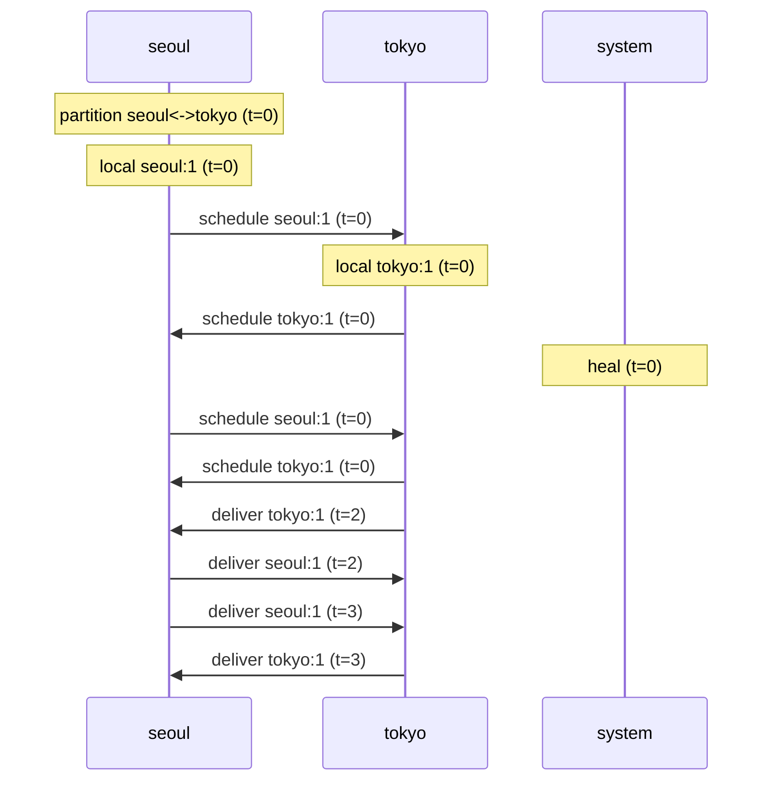

# causal-lab 데모: 이 프로젝트가 뭘 하는 건지

## 한 줄 요약

**분산 시스템에서 "네트워크가 끊겨도 데이터가 결국 같아지는가?"를 시험하는 시뮬레이터.**

실제 예시로 보여드립니다.

---

## 실제 문제 상황 (이 프로젝트가 푸는 것)

서울과 도쿄에 데이터베이스 복제본(replica)이 있습니다. 둘 다 "리더가 누구인지"를 `leader` 키에 저장합니다.

어느 날 **서울-도쿄 간 네트워크가 끊겼습니다**(파티션). 이때:

1. 서울은 "내가 리더다"라고 씁니다 → `leader = seoul`
2. 도쿄도 "내가 리더다"라고 씁니다 → `leader = tokyo`

네트워크가 끊긴 상태에서는 **서로 다른 답**을 가집니다. 이걸 시뮬레이터로 재현해봅시다:

```
partition seoul tokyo       ← 네트워크 분할
put seoul leader seoul      ← 서울이 쓰기
put tokyo leader tokyo      ← 도쿄가 쓰기 (서로 모름)
```

상태 확인 (분할 중):
```json
{
  "converged": false,           ← 수렴 안 함 (서로 다름!)
  "seoul": { "leader": ["seoul"] },
  "tokyo": { "leader": ["tokyo"] }
}
```

---

## 핵심: heal(복구)하면 어떻게 되나?

이제 네트워크를 복구합니다:
```
heal                          ← 분할 해제 + 안정적 동기화
run                           ← 실행
```

결과:
```json
{
  "converged": true,            ← 수렴! 서로 같아짐
  "seoul": { "leader": ["seoul", "tokyo"] },
  "tokyo": { "leader": ["seoul", "tokyo"] }
}
```

**둘 다 `["seoul", "tokyo"]`를 가집니다.** 한쪽을 덮어쓴 게 아니라 **양쪽 값을 모두 살렸습니다.** 이게 CRDT(observed-remove map)의 핵심입니다:

- 일반 DB였으면 "마지막에 쓴 사람이 이김(last-write-wins)" → 한쪽 값 사라짐
- CRDT는 **동시에 쓴 값은 둘 다 보존** → 데이터 손실 없음

---

## 시각화: 시퀀스 다이어그램

위 시나리오의 메시지 흐름을 Mermaid로 그리면:



읽는 법:
- `partition` → 네트워크 분할 시작
- `local` → 각자 자기 복제본에 쓰기
- `schedule` → 메시지 예약 (분할 중엔 상대에게 못 감)
- `heal` → 분할 해제, 이제 쌓였던 메시지가 전달됨
- `deliver` → 메시지 도착, 상태 합침
- 최종적으로 양쪽이 같은 상태로 수렴

---

## 왜 유용한가?

1. **분산 시스템 버그는 재현이 극히 어렵다** — "네트워크가 잠깐 끊겼을 때 어떻게 되나?"를 실제 환경에서 시험하려면 수십 대 서버와 네트워크 제어가 필요합니다. 이 시뮬레이터는 **가상 시간** 한 대에서 1초 만에 시험합니다.

2. **결정론적 재현** — 같은 시나리오를 넣으면 기계를 바꿔도 **byte 단위로 같은 결과**가 나옵니다. 버그 리포트에 시나리오 JSON 하나만 첨부하면 누구나 동일한 버그를 재현할 수 있습니다.

3. **안전한 병합 검증** — CRDT 라이브러리를 만들거나 고를 때, "이 라이브러리가 정말 모든 경우에 수렴하는가?"를 속성 기반 테스트로 자동 검증할 수 있습니다.

4. **교육용** — FoundationDB, Antithesis, TigerBeetle 같은 회사들이 쓰는 "결정론적 시뮬레이션 테스트(DST)" 패러다임을 직접 만져볼 수 있습니다.

---

## 직접 해보기

```sh
pnpm repl
> partition seoul tokyo
> put seoul leader seoul
> put tokyo leader tokyo
> heal
> run
> mermaid          ← 이 시나리오의 시퀀스 다이어그램 출력
```

또는 준비된 예시 실행:
```sh
pnpm start
curl -X POST http://127.0.0.1:8787/v1/run -H 'content-type: application/json' -d @examples/partition-heal.json
```
